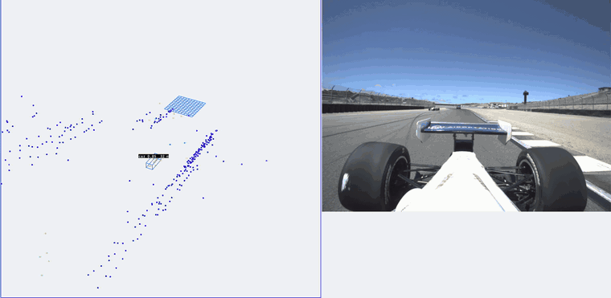

# Rear-Radar Car Detection for Autonomous Racing

Detecting the car behind us at racing speed, using only a 4D imaging radar.

*Left: rear radar returns (dots) with the detector's output box and score. Right: the rear
camera, shown for reference only; the model never sees it. Recorded at Laguna Seca on a
session the model was not trained on. Played at 4× speed.*

## The problem

In head-to-head autonomous racing, the AV-24 race car has to know where the car behind it is.
That information drives defending, merging back onto the racing line, and staying safe
while being overtaken. The rear is covered by a ZF FRGen21 **4D imaging radar** (x, y, z plus Doppler velocity, at 16 Hz).

Radar is a hard input for a detector:

- **Sparse and noisy.** A car 40 m back may return only a handful of points, and the
  elevation is too noisy to trust.
- **Cluttered.** Walls, barriers and kerbs return far more points than the opponent does.
- **Doppler folding.** Above about 20 m/s of ego speed, the sensor's velocity reading wraps
  around. Stationary clutter can then look like a moving target unless this is corrected.
- **No labelled data.** No public dataset covers a race-car rear radar at race speed. Every
  label had to be generated.

The goal is a detector that reports the opponent's position (a 3D box and a confidence
score) in real time. Its output feeds a Kalman tracker on the car.

## How it works

### 1. Automatic labelling from both cars' odometry

Labelling radar by hand isn't practical, so the opponent cars' own odometry (GNSS/INS)
is recorded alongside ours. The pipeline in
[`build_nuscenes_dataset.py`](build_nuscenes_dataset.py) then:

- aligns the two cars' clocks and map frames, and puts a car-sized box at the opponent's
  pose in our rear-axle frame;
- corrects each radar point's Doppler for ego motion (including the yaw-rate lever arm) and
  undoes velocity folding;
- keeps a frame as a positive only if the box contains returns that are actually moving,
  so a box drawn over a wall is never labelled as a car;
- runs quality gates that catch bad labels automatically, such as boxes that sit sideways
  of the opponent's returns, or returns that stop short of the box's near face;
- writes everything in the **nuScenes v1.0** format, with sweeps, splits and 20%
  "no car behind" background frames.

Sensor mounting comes from the car's URDF, and per-session calibration (clock source,
time offsets, box offsets) lives in [`config/runs/`](config/runs). A separate validator,
[`validate_nuscenes_dataset.py`](validate_nuscenes_dataset.py), reads the whole dataset
back through the official nuScenes devkit and checks the schema, point files, labels and
splits.

### 2. Model: RadarPillar

The detector is [RadarPillar](https://github.com/fthbng77/RadarPillar), a PointPillars
variant for 4D radar, built on OpenPCDet. It's adapted in
[`training/`](training) with:

- **4 stacked scans** (about 0.19 s). The opponent follows at nearly our speed, so its
  returns stay aligned across scans while static clutter smears out.
- **Doppler-consistent augmentation.** Ordinary flips and rotations would make the
  velocity features physically wrong, so the custom augmentations re-project the radial
  velocity after every geometric transform.
- **A centre-distance metric** (AP at a 1 m match) alongside BEV IoU. The tracker consumes
  box centres, and IoU is harsh on along-track error for a 4.9 m car.

### 3. Live ROS 2 node

[`live/`](live) re-implements the trained network and its post-processing in plain
PyTorch. It runs on a laptop CPU with no GPU or OpenPCDet, at **40–55 ms per scan**, well
inside the radar's 62 ms frame time. It publishes detections, RViz/Foxglove markers and a
status topic.

## Data and results

Each split is a different session, so train and test never share a lap:

| split | track | opponent | scenes | samples |
|---|---|---|---:|---:|
| train | Laguna Seca (2 sessions) | Purdue, IU | 136 | 13,869 |
| val | Putnam Park | Caltech | 22 | 2,587 |
| test (held out) | Putnam Park | IU | 43 | 456 |

On validation, which is a **different track** from training, the current model reaches
about **75 centre-distance AP at 1 m**. Scored on unseen sessions from the training
track, earlier versions reached about 92. The gap shows that generalising to a new
track, not fitting, is the open problem.

## Repository layout

| path | what it is |
|---|---|
| `build_nuscenes_dataset.py` | decode bags, auto-label, write the nuScenes dataset |
| `validate_nuscenes_dataset.py` | end-to-end checks through the nuScenes devkit |
| `visualize_nuscenes.py` | bird's-eye-view images of labels for QA |
| `av24_geometry.py` | car and sensor geometry from the AV-24 URDF |
| `config/` | pipeline policy and per-session calibration |
| `training/` | RadarPillar patch, radar dataset, augmentation, evaluator, Slurm jobs |
| `live/` | real-time ROS 2 detector node and model export |
| `third_party/` | vendored car URDF and shared odometry/geometry code |

Build, training and deployment commands are in [docs/USAGE.md](docs/USAGE.md).

**Stack:** Python, PyTorch, OpenPCDet, ROS 2, nuScenes devkit, NumPy, Slurm (HPC GPU training).
